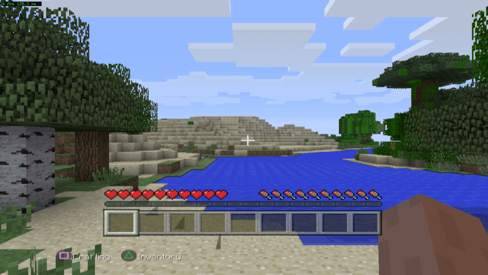

<p align="center">
  
</p>

# Project Creeper (work in progress)

**Minecraft: PlayStation 3 Edition: unofficial PC port (static recompilation)**

<a href="https://recomplauncher.com"><picture><source media="(prefers-color-scheme: dark)" srcset="https://recomplauncher.com/assets/press/launcher/badge-light.svg"></picture></a>


**[Status](#status)** · **[Features](docs/FEATURES.md)** · **[Screenshots](docs/SCREENSHOTS.md)** ·
**[Requirements](docs/requirements.md)** · **[Getting your files](docs/GETTING-FILES.md)** ·
**[Building](docs/BUILDING.md)** · **[How it works](docs/HOW-IT-WORKS.md)** · **[Known issues](docs/KNOWN_ISSUES.md)** ·
**[Roadmap](docs/ROADMAP.md)** · **[AI use](#how-ai-was-used)** · **[Contributing](.github/CONTRIBUTING.md)**

*Creeper* is the game's own signature character. Project Creeper is a fan project, not official and not affiliated
with or endorsed by Sony Interactive Entertainment, Mojang Studios or Microsoft.

**What this is:** a static recompilation of **Minecraft: PlayStation 3 Edition** (title **BLES01976**, Europe,
v01.02). The game's PowerPC (PPU) code and its Cell SPU programs are translated to C++ ahead of time and compiled into
a native Linux x64 program. It is **not an emulator** (no CPU emulator runs at play time) and **not a rewrite** (the
game's logic is the game's own code). Around that code, the PS3's system libraries are reimplemented and the game's
graphics commands are replayed on Vulkan.

**You need your own copy of the game.** This repository contains only the port: source code, patches, tools and
documentation. It contains no game code, data, assets, keys or firmware, and it never will. Each player translates
and builds the game's code on their own machine, from their own files.

## Status

As of 2026-11-10, on Linux x64 with an NVIDIA RTX 4060 Laptop GPU, the maintainer's machine:

| | |
|---|---|
| Code translation | the game's PPU code is fully translated; **65% to 0%** of SPU instructions reach the interpreter after the recorded generation blocks are compiled, measured during world generation |
| Boot | the title loads, starts its SPURS kernel group and presents frames |
| Menus | the text renders legibly; the main menu, the PSN dialogue and the full world-creation form are reachable |
| World creation | a new world is created, saved and written to the VFS, proven **10 times out of 10** |
| Gameplay | movement, breaking a block, the inventory, and placing a block in **Survival** all work, driven by real input with no forcing |
| Sound | imported and initialised; not verified by ear in this environment |
| Saves | written; loading an existing world has a known defect |

What works and what does not, item by item: [docs/FEATURES.md](docs/FEATURES.md). Open problems:
[docs/KNOWN_ISSUES.md](docs/KNOWN_ISSUES.md).

## How to play

You need the **decrypted `EBOOT.elf` from your own BLES01976 disc** (Europe, v01.02) and the decrypted
firmware modules of your own PS3 dump, together in one folder: `EBOOT.elf` and `fw/` beside it. What each
file must be is in [docs/GETTING-FILES.md](docs/GETTING-FILES.md); how you obtain and decrypt them is yours to
do, with your own tools, from your own disc.

**With RecompLauncher**, drop that folder on the game's setup screen. It checks the copy, runs
`tools/install.sh --prepare` to translate and build the game's code from your files, and then Play starts it.
The translation takes a while the first time, because every function of the game is compiled on your PC.

**By hand**, from a clone: see the command below.

## Getting it

There is no release yet. From a clone:

```sh
git clone https://github.com/Noext/mc-ps3-port creeper
cd creeper
tools/install.sh     # asks where your files are, checks them, lifts and builds
tools/play.sh        # plays in a window
```

You need:

- the decrypted **EBOOT** of your own **BLES01976** disc (Europe, v01.02), and the decrypted firmware modules of your
  own PS3 dump. What each must be is in [docs/GETTING-FILES.md](docs/GETTING-FILES.md);
- Linux x64 with clang, CMake, Ninja, Python 3 and the Vulkan headers;
- a CPU with AVX2 (x86-64-v3) and a Vulkan GPU.

## How it works, briefly

- **PPU:** the game's PowerPC functions are lifted to C++ ahead of time and compiled with clang.
- **SPU:** this is the part that takes the work. The game uploads SPU programs at run time (SPURS jobs, world
  generation), so the set of blocks to compile is discovered by running the game with recording on, compiling what it
  produced, and repeating until a round collects nothing new. See [docs/HOW-IT-WORKS.md](docs/HOW-IT-WORKS.md).
- **Graphics:** the game's RSX command stream is replayed on Vulkan.
- **Data:** the game reads its own files through its own file system code.

## How AI was used

This project is developed with AI coding agents. The agents did most of the work of reading the game's binary and
reference material, writing and testing patches, tools and documentation, and running the builds, with the maintainer
setting the goals, playing and checking the game, and deciding what is published. Findings are dated. An
`ASSUMPTION:` in the code or the docs is not fact. If you find a statement here that was not verified, please open an
issue.

## Related projects

- [Project Vekta](https://github.com/gustavomorinaga/project-vekta) (Killzone HD), and through it
  [Project Helghast](https://github.com/undecuple/project-helghast) and
  [Project Pyrrhus](https://github.com/undecuple/project-pyrrhus): the model for this repository's layout. Credits:
  [NOTICE.md](NOTICE.md).
- [ps3base](https://github.com/snuri00/GoWA-pc), the generic PS3 static-recompilation runtime this port's runtime is
  forked from.

## Repository layout

| Path | What it holds |
|---|---|
| `port/creeper/` | the port's own code: boot, HLE overrides, the corrections this title needs |
| `port/manifests/` | the image manifest the lifter reads. The SPU block manifest is **not** here: it is generated from the player's own captures |
| `tools/` | `env.sh`, `install.sh`, `setup-vfs.sh`, `lift.sh`, `converge.sh`, `build.sh`, `play.sh`, `package.sh`, `check-tree.sh` |
| `docs/` | the public documentation; `docs/dev/` holds engineering notes |

## Licence

The port is MIT ([LICENSE](LICENSE)): that licence covers the port only, its code, patches, tools and documentation.
Third-party parts and credits are in [NOTICE.md](NOTICE.md). Minecraft is a trademark of Mojang Studios; nothing of
the game is licensed or included here.
