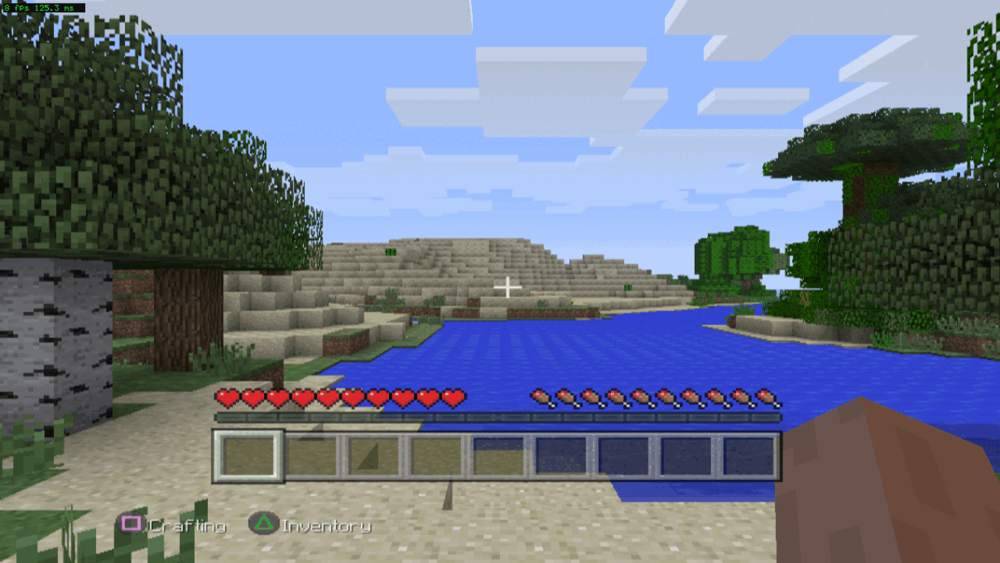
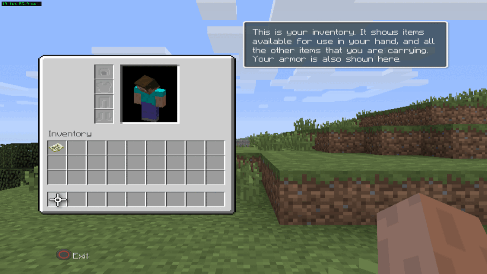
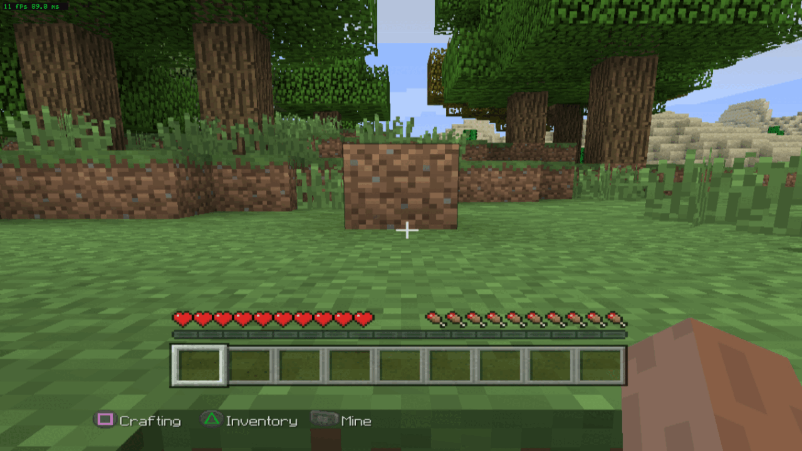
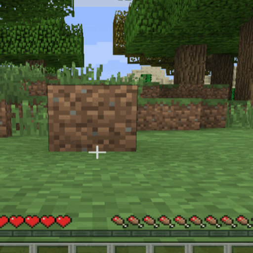

# Screenshots

All taken from the port running on Linux x64 with an NVIDIA GPU, presented through Xvfb (software presentation,
which is why the frame rate reads lower than the renderer is capable of).

## A generated world

The proof that world generation completes: the terrain, the sky and the player are all the game's own output.

## Playing

The inventory screen: player model, armour slots, the 9x3 grid. Everything here is drawn by the title.

A block placed in a Survival world. The HUD reads `L2 Place` when the hand holds a block, which is what makes this
checkable rather than a matter of opinion.

## The icon

A 512×512 square cut from `place-survival.png`: a block placed in Survival, against the trees and the grass. It is
the image a store listing or a launcher wants, and it is made from the port's own output rather than drawn.

## What these do not show

Audio. A screenshot cannot settle whether the game's mixer is correct, and no claim is made here that it is.
